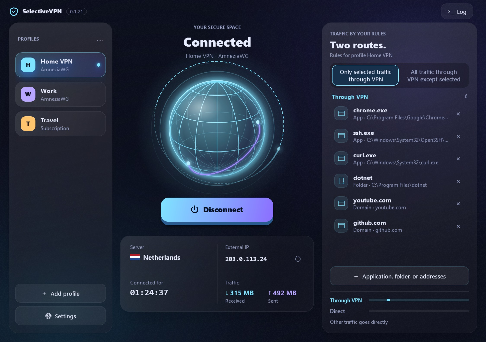
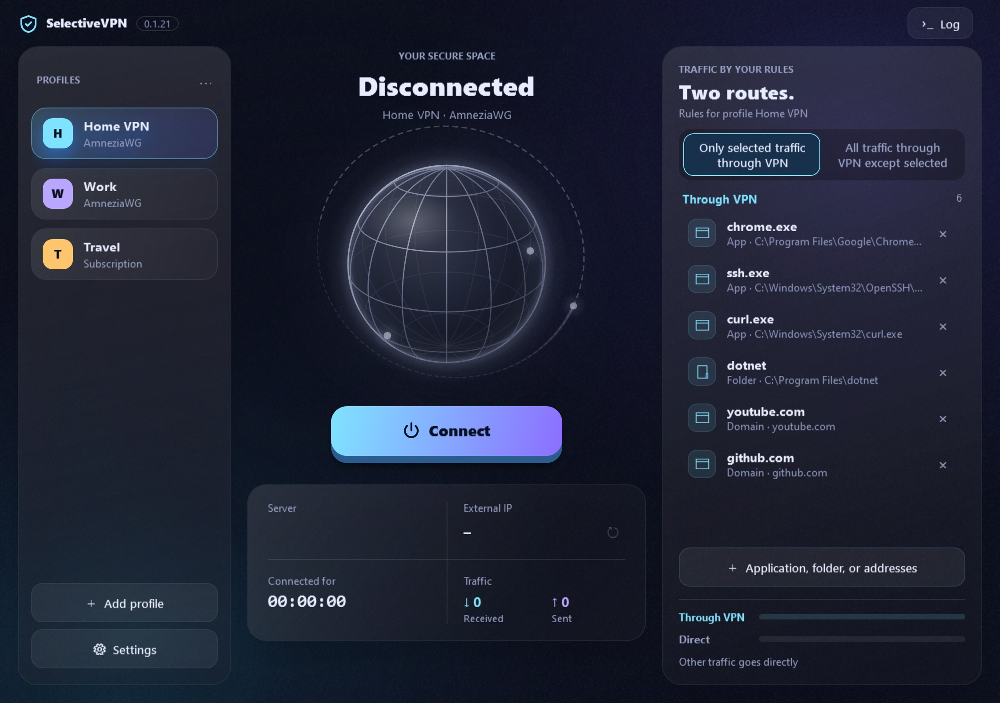
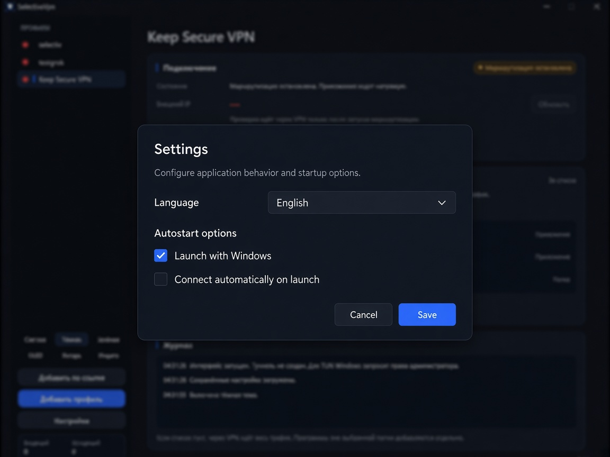

# SelectiveVpn

Windows client for **selective VPN routing**: send only chosen apps, folders, or address lists through the tunnel — or everything except a deny list.

Built with **.NET / WPF**, powered by **Mihomo** and **AmneziaWG** configs / subscription links.

[](https://github.com/fullspb/SelectiveVpn/releases/latest)

<p align="center">
  
</p>

## Features

- **Profiles** — multiple AmneziaWG configs, subscription URLs, or pasted server links (`vless://`, `vmess://`, `trojan://`, `ss://`) side by side
- **Selective routing** — apps (`.exe`), folders, and address lists per profile
- **Except-list mode** — all traffic via VPN except the listed targets
- **Server picker** — choose a node from a subscription (with ping when available)
- **Orbit interface** — connection control, per-profile routing, current server/IP, and a collapsible event log
- **Color schemes** — Orbit, Northern lights, Ocean, Plum, Sunset, Graphite; chosen in Settings
- **Languages** — Russian, English, Spanish, Portuguese, Chinese (+ Auto)
- **Tray** — minimize to tray, connect / disconnect / exit; menu follows the app theme
- **Autostart** — launch with Windows and optional connect-on-start
- **Apply routing changes** — explicit reconnect action for the running profile
- **Optional recovery** — up to three attempts after an unexpected engine stop; manual disconnect cancels recovery
- **Installer** — self-contained Windows setup with bundled Mihomo

## Screenshots

### Connected


### Disconnected



### Settings



> Screenshots use demo profiles (`Home VPN`, `Work`, `Travel`), sample routing targets, and a documentation-range IP address.

## Install

1. Open the [latest release](https://github.com/fullspb/SelectiveVpn/releases/latest)
2. Download `SelectiveVpn-Setup-*.exe`
3. Run the installer

Windows may ask for **administrator** rights when creating the TUN adapter.

### Requirements

- Windows 10 / 11 (x64)
- .NET runtime is **not** required for the installer build (self-contained)

## Quick start

1. **Add profile** — import an AmneziaWG `.conf` / `.json`, or **Add by link** for a subscription URL or one or more `vless://` server links  
2. Optionally pick a **server** for subscription profiles  
3. Add apps / folders / address lists for selective routing (empty list ⇒ all traffic via VPN)  
4. Press **Start**

## Build from source

```powershell
dotnet build SelectiveVpn\SelectiveVpn.csproj -c Release
```

Installer (needs [Inno Setup 6](https://jrsoftware.org/isinfo.php)):

```powershell
powershell -ExecutionPolicy Bypass -File installer\build-installer.ps1
```

Output: `installer\output\SelectiveVpn-Setup-<version>.exe`

## Checks

Core parsing, routing generation, startup cleanup and active-profile snapshot regressions:

```powershell
dotnet test SelectiveVpn.Tests\SelectiveVpn.Tests.csproj -c Release
```

Windows WPF command and popup regressions (isolated fake controller, temporary profiles, no real VPN or user settings):

```powershell
dotnet run --project SelectiveVpn.UiTests\SelectiveVpn.UiTests.csproj -c Release
```

The UI checks cover profile/server isolation, reconnect, cancellation, stale IP/server responses,
bounded opt-in recovery, settings, and actual popup creation including separators and submenus.

## Project layout

| Path | Role |
|------|------|
| `SelectiveVpn/` | WPF UI |
| `SelectiveVpn.Core/` | Mihomo engine, config / subscription parsing, traffic |
| `SelectiveVpn.Tests/` | Unit tests |
| `SelectiveVpn.UiTests/` | Isolated WPF regression checks |
| `installer/` | Publish script + Inno Setup |

## Notes

- Removing a profile removes it from the app list; the config file on disk is kept
- Address lists can resolve domains to IPs when routing starts
- Single-instance: launching again focuses the existing window

## Privacy

- [Privacy policy](docs/privacy.md) (RU / EN)
- [Microsoft Store listing copy](docs/store-listing.md)

## Microsoft Store (MSIX)

```powershell
powershell -ExecutionPolicy Bypass -File msix\build-msix.ps1
```

Output: `msix\output\SelectiveVpn-<version>-x64.msix`. Details: [docs/msix.md](docs/msix.md).

## Disclaimer

SelectiveVpn is a personal / community client. You are responsible for complying with local law and your VPN provider’s terms. Do not commit or share private keys or subscription tokens in issues or PRs.
